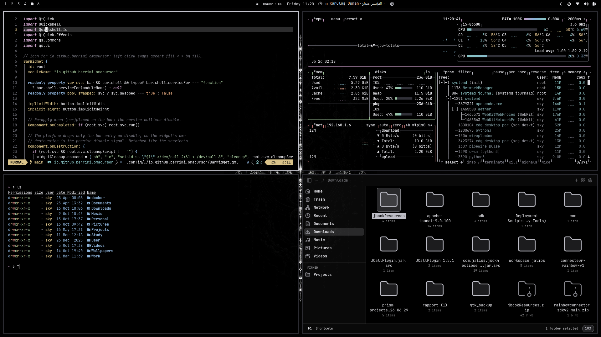

# Astra

Astra is an OLED-first Omarchy theme built around true black, silver-gray neutrals, and soft celestial accents. Inspired by cosmic diagrams and mythical artifacts, it keeps the desktop minimal while adding subtle color and mystery.

## Preview



## Palette

- **Base:** true black and charcoal
- **Foreground:** silver and off-white
- **Accents:** muted blue, cyan, violet, rose, green, and pale gold

## Installation

Place the theme in `~/.config/omarchy/themes/astra/`, then activate it with:

```bash
omarchy theme set astra
```
